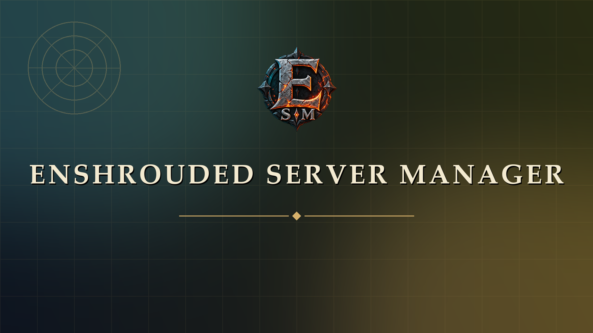

# Enshrouded Server Manager



A Windows desktop client for running Enshrouded dedicated servers, with a built-in live map. It reuses the process,
SteamCMD and backup logic from ESM-Z (Enshrouded Server Manager by Zat).

License: MIT (see LICENSE).

## Features

- Add an existing server folder, or install a new one with SteamCMD (app `2278520`).
- Start, stop and restart servers. Servers are started detached, so closing the client does not stop them.
- Auto-restart a server if it crashes after the client started it.
- Edit `enshrouded_server.json`: name, password, slots, query port, voice/text chat, and world settings.
  World settings have presets (Relaxed, Default, Hard, Survival, Custom) and, under Custom, sliders for player,
  survival, world, progression and enemy values. Raw JSON mode edits everything else, including user groups and bans.
- Read server logs from the `logs` folder.
- Create, restore and delete backups of the config and save folder. Restore takes a safety backup first.
- Check for server updates with SteamCMD (the server must be stopped).
- **Daily restarts:** set one or more restart times per server (local time). Each restart stops the server, optionally
  checks for an update first, then starts it again. Only running servers restart; a stopped server stays stopped.
- **Automatic backups:** back up every 1, 3, 6, 12 or 24 hours and keep the newest N automatic backups (default 7).
  Manual backups are never pruned.
- **Discord alerts:** post start, stop, crash, scheduled restart, update and automatic backup events to a Discord
  channel through a webhook. Each event can be turned on or off, and a test alert checks the setup.

Enshrouded does not expose a REST API like Palworld does, so live data comes from the query port instead:

- **Players online:** while a server runs, the client sends a Steam-style `A2S_INFO` request to its query port
  every 15 seconds and shows the count on the cards and in the Players tab. This is not yet confirmed against a live
  Enshrouded server. The **Probe query port** button shows the raw reply, so you can check it.
- **Online names:** the server log records each join (`Player 'Name' logged in`) and each leave
  (`Remove Player 'Name'`). The client reads new lines from `enshrouded_server.log` every 10 seconds and lists who is
  online, plus recent join and leave events. The names are checked against a real log. The times shown are when the
  client read each line, not when the player joined.
- Restarting the server clears the list, because the server writes a new `HostOnline` session line.
- The online list also appears on the server's Overview tab.

## Look

The title runs across the top with a banner image, and the main pages are on the bottom navigation bar. The
interface uses a slate-teal background with gold accents and serif headings, to match the game's own menus. It is
not the Discord-style look of the Palworld manager. Dark is the default, and the sidebar toggle or the Theme setting
switches to a parchment-coloured light theme.

**Banner art:** the banner shows `renderer\assets\splash.webp` if that file exists. Without it, a painted gradient is
shown. The current image is a game screenshot you supplied. Enshrouded's artwork belongs to Keen Games, so replace it
with artwork you have the right to use if you share this client.

## Screen refresh

Settings → General → **Screen refresh** sets how often the server cards, Overview and Players tab re-read their
data. The default is every 2 minutes. Choose from 5 seconds up to 5 minutes. The Players tab also has a Refresh
button for an immediate update. Server monitoring (crash recovery, schedules, backups) and the player and CPU/RAM
readings keep their own 10-second cycle; this setting only changes what's redrawn on screen.

## Settings and game updates

- **Settings page:** general options (theme, start with Windows, start minimized, close-to-tray, start servers that
  were running, folder for new installs), desktop and Discord notifications, and the defaults for new servers
  (automatic backups, restart times, crash restart and update options). Changes apply to new servers only;
  existing servers keep their own settings.
- **Build version:** each server's Overview shows its installed Steam build, read from
  `steamapps\appmanifest_2278520.acf`, and the latest public build once it has been checked.
- **Game updates** (Schedule tab): choose whether to check for new builds every 6, 12 or 24 hours, update before
  every start, and install new builds when the server is stopped. A build that is found while the server runs
  waits until the server stops. Checks ask SteamCMD for the public branch, which doesn't change the server.

## CPU, memory and tray

- **CPU and RAM:** each running server's CPU share and memory use are read every 10 seconds, through PowerShell's
  `Get-Process`. CPU shows a value after the second reading. This works on Windows only.
- **System tray:** the client has a tray icon. Its menu lists each server with Start, Restart and Stop, plus the
  player count while a server runs. Closing the window hides it to the tray by default, and the tray menu turns that
  off. Quit is in the tray menu.
- **Crash notifications:** a Windows notification appears when a server stops unexpectedly.
- Only one copy of the client runs at a time. Launching it again brings the open window forward.

## Schedule and alerts notes

- Automatic backups can run while the server is up. A save written at that moment can be copied half-finished, so
  the restart times are the safer point for a backup. Restores always need the server stopped.
- The Discord webhook URL is stored in plain text in `data\app-settings.json`. Anyone who can read that file, or the
  channel, can post as the webhook. Keep the `data` folder private.
- Scheduled restarts run while the client is open. If the client is closed at a restart time, nothing restarts.

## World settings notes

- The server ignores the `gameSettings` values unless `gameSettingsPreset` is `Custom`, so the sliders stay locked
  for the other presets. They show that preset's values instead, taken from the
  [Enshrouded wiki's World Settings page](https://enshrouded.wiki.gg/wiki/World_Settings). Use **Apply to Custom**
  to copy a preset's values into editable sliders.
- The wiki lists no values for a few settings (enemy amount, simultaneous enemy attacks, enemy attack frequency,
  weapon upgrade cost, taming startle), so those are not in the sliders. Edit them in Raw JSON.
- The wiki's Relaxed Mining XP (125%) is marked buggy, and the wiki says it can only be reached through the Relaxed button.
- Slider percentages map to factors, so 75% is saved as `0.75`. Durations are saved in nanoseconds, as the server expects.
- Only values you change are written back, so anything you don't touch keeps its exact value from the file.
- The curse labels (Off, Default, High) come from the wiki, but their mapping to the config values Easy, Normal and
  Hard is inferred. Check it in game.

## Portable build (no install)

```bash
npm install
npm run dist
```

This writes `release\EnshroudedServerManager-<version>-portable.exe`. It is a single file: copy it anywhere and
double-click it. Nothing is installed and no admin rights are needed. The portable build keeps its data in a `data`
folder next to the `.exe`, so move the `.exe` and `data` together.

## Run from source

Requirements: Windows 10/11 and Node.js 20 or newer.

```bash
npm install
npm start
```

Or double-click `Launch Manager.bat` after `npm install` has run once. From source, data goes to the per-user app
data folder instead.

## Test

```bash
npm test
```

The tests cover the server logic (registry, config validation, backups, restore, logs, start errors, schedule
rules, automatic backup pruning, alert settings). They do not start a real Enshrouded server or post to Discord.

## Ports

Open these on the host if players connect from outside your network:

- Game port: UDP `15636`
- Query port: UDP `15637` by default (per server; set in Settings)

## Data

Data lives in the `data` folder next to the portable `.exe`, or in `%APPDATA%\enshrouded-server-manager\data` when run from source:

- `servers.json` - the server list
- `backups\<server-id>\` - backup zips
- `steamcmd\` - SteamCMD, downloaded on first install
- `app-settings.json` - Discord webhook and alert choices
- `manager.log` - activity log

Removing a server from the list never deletes its files.

## Layout

- `electron/main.js` - window and IPC handlers
- `electron/preload.js` - the `window.esm` API the UI uses
- `electron/server-manager.js` - process control, SteamCMD, config, backups, logs
- `renderer/` - the UI (`index.html`, `styles.css`, `app.js`)
- `test/` - tests for the server logic
